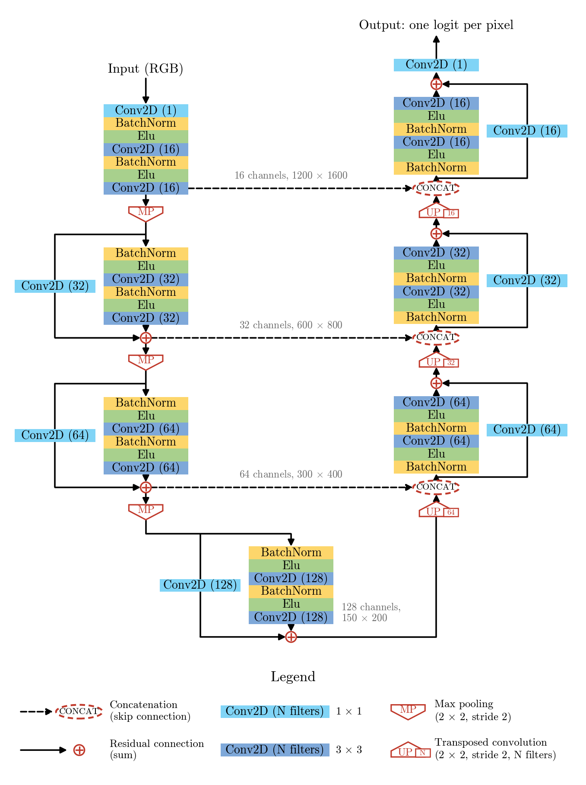

# c-FOS nuclei segmentation — Fluorescent Neuronal Cells v2, Green collection

Segmentation (and counting) of c-FOS-stained neuronal nuclei in the **Green** collection of the
Fluorescent Neuronal Cells v2 dataset (Clissa et al., 2024), with a light c-ResUNet trained from scratch.

## Adopted pipeline

```
image → c-ResUNet-light (runs/cresunet_light/best.pt, 0.50 M parameters) → probability map
      → threshold 0.5 → fill holes → remove objects < 300 px
      → watershed on the distance transform (seeds at least 20 px apart)
      → object classifier (logistic regression on 10 object features, keep if P(true) ≥ 0.34; border objects always kept)
      → labelled cells and their count
```

c-ResUNet-light is the c-ResUNet of Morelli et al. (2021) without the residual block with 5 × 5 kernels at the end of the
encoder. The c-ResUNet is the ResUNet of Zhang et al. (2018) with two additions, a learned colour conversion (1 × 1
convolution) and that block, which enlarges the field of view; the two were evaluated only together, on another collection
(Yellow). c-ResUNet-light keeps the first addition and drops the second: on Green the block brings no measurable gain, for
2.6× the parameters (notebook 02).

<p align="center"></p>

*c-ResUNet-light, drawn as Fig. 2 of Morelli et al. (2021): each box is a layer; the 1 × 1 convolutions on the solid
arrows are the shortcuts of the residual blocks. The network returns one logit per pixel; the sigmoid that turns it into
the probability of cell is applied outside the network (in the loss during training, in `evaluation/predict.py` at
inference).*

## Results on the test set

70 images never used for training or for any choice, 1172 annotated cells; object F1 with matching at IoU > 0.5, 95%
bootstrap interval over the images (notebook 04).

| method | object F1 | precision | recall | pixel Dice | count error (MAE) |
|---|---|---|---|---|---|
| **adopted pipeline** | **0.834** [0.810, 0.858] | 0.807 | 0.864 | 0.758 | 3.9 |
| Cellpose-SAM fine-tuned on the same images | 0.819 | 0.861 | 0.782 | 0.743 | 3.8 |
| Cellpose-SAM zero-shot | 0.574 | 0.412 | 0.944 | 0.579 | 21.6 |
| robust threshold (median + 6.5 MAD) | 0.506 | 0.441 | 0.595 | 0.579 | 9.8 |

The adopted pipeline is at the level of Cellpose-SAM fine-tuned (no demonstrable difference in F1), with ~600× fewer
parameters and runs on a CPU. Most remaining errors are faint cells whose annotation is itself ambiguous (notebooks 03 and 04).

## Notebooks

| notebook | content |
|---|---|
| `01_eda_green.ipynb` | data, mask cleaning, morphology of the Green cells |
| `02_data_and_training.ipynb` | split, dataset and augmentation, model, loss, training, variants tried |
| `03_post_processing.ipynb` | from probabilities to cells: threshold, minimum area, watershed, object classifier |
| `04_test.ipynb` | evaluation on the test set and comparison with other methods |

## Structure

```
notebooks/        the four notebooks above
models/           c-ResUNet (c_res_unet.py), its logit-output version used for training, and c-ResUNet-light
                  (c_res_unet_small_rf.py: no 5×5 residual block in the bottleneck; diagram: c_resunet_light.png)
train/            dataset, loss, training script, train/val split and 5-fold split
evaluation/       prediction, post-processing, object features and classifier, metrics
experiments/      the experiments that were tried: notebook (experiments.ipynb), index of the results, TTA code
splits/           train/val split and the 5 cross-validation folds
runs/             saved results read by the notebooks: cresunet_light/ (adopted network and classifiers), cresunet/
                  (c-ResUNet, Morelli et al.), cresunet_light_cv*/, cresunet_light_wm_cv*/ and cv_compare/ (cross-validation),
                  cresunet_light_<variant>/ (training variants)
other_methods/    the methods we compare with (threshold baselines, Cellpose) and how they were obtained
kaggle/           notebooks run on a Kaggle GPU (training, cross-validation, recipe variants) and how to run them;
                  executed/: the same notebooks as they ran, with their outputs
data/             not included (see How to run)
requirements.txt  versions of the local environment
```

## How to run

### Setup

Clone the repository, create a Python 3.12 environment and install the dependencies (`requirements.txt` lists the versions
of the local environment):

```bash
git clone https://github.com/alirammal-ux/FNC_segmentation.git
cd FNC_segmentation
python -m venv venv
source venv/bin/activate
pip install -r requirements.txt
```

Everything runs from the repository root, so that `models`, `train`, `evaluation`, `experiments` and `other_methods` are
importable.

### Data

Download the Green collection (Clissa et al., 2024, AMS Acta, University of Bologna) into `data/`:

```bash
wget -c https://amsacta.unibo.it/7347/28/green.zip
unzip green.zip -d data/
```

Then run `notebooks/01_eda_green.ipynb`: it creates the cleaned masks (`data/cleaned_masks/{trainval,test}/Green/masks`)
used by everything else.

### Training (optional: the trained network is saved in `runs/cresunet_light/`)

The network was trained on a Kaggle T4 GPU (~1 h) with `kaggle/train.ipynb` (see `kaggle/README.md`), which runs:

```bash
python -m train.training \
  --images_dir data/green/trainval/images \
  --masks_dir data/cleaned_masks/trainval/Green/masks \
  --split_json splits/green_split.json \
  --out_dir runs/cresunet_light \
  --small_rf --epochs 100 --patience 100
```

`--small_rf` builds c-ResUNet-light; `--patience 100` disables early stopping. Output: `best.pt`, `last.pt`, `log.csv`,
`config.json`.

### Object classifier (optional: saved in `runs/cresunet_light/object_classifier/`)

Probability maps of the training and validation images, then the selection and the fit of the classifier:

```bash
for s in train val; do
  python -m evaluation.predict --ckpt runs/cresunet_light/best.pt --subset $s \
    --images_dir data/green/trainval/images \
    --masks_dir data/cleaned_masks/trainval/Green/masks \
    --split_json splits/green_split.json \
    --out runs/cresunet_light/pred_$s.npz
done
python -m evaluation.watershed_classifier
```

### Notebooks and test (CPU)

Run `notebooks/02_data_and_training.ipynb`, `03_post_processing.ipynb` and `04_test.ipynb` in order: they load the
checkpoints and classifiers saved in `runs/`. `04_test.ipynb` evaluates the pipeline on the 70 test images (about 10
minutes).
